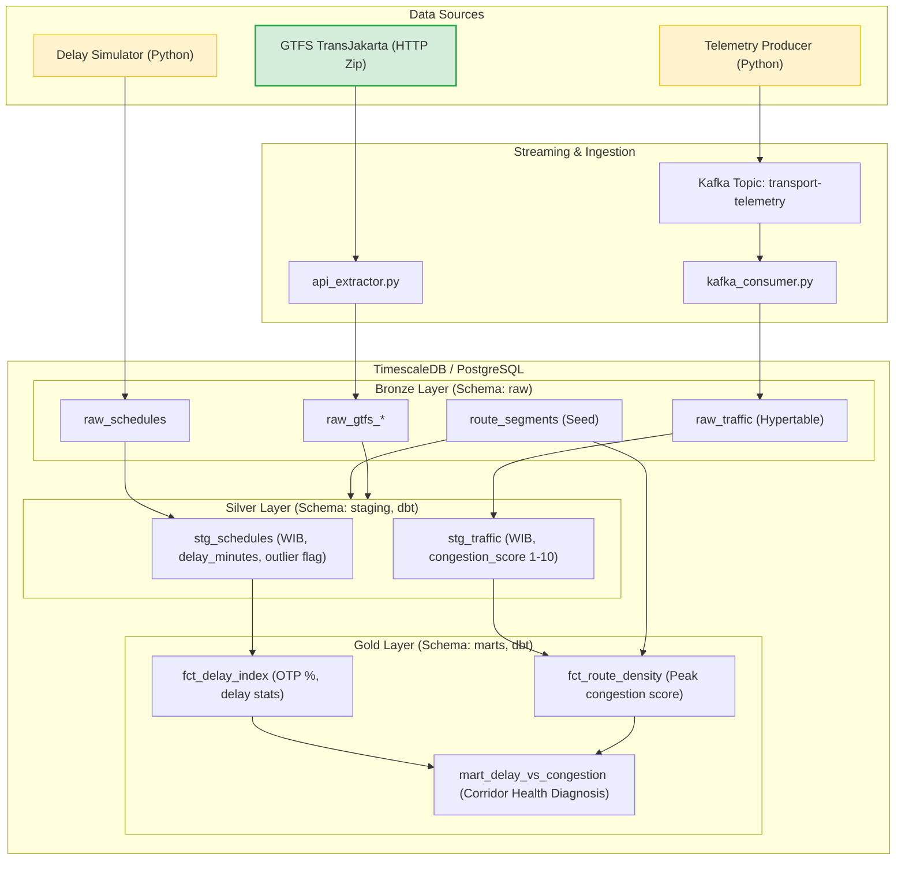

# 🚌 ITMA: Indonesian Transport & Mobility Analytics
**Versi 1.1 · Status: Portfolio / Learning Project · Author: Data Engineering Team**

> [!NOTE]
> Proyek ini adalah **portfolio data engineering** untuk mendemonstrasikan kemampuan membangun end-to-end data pipeline. Data telemetri dan jadwal aktual adalah **sintetis** (ditandai `is_synthetic = true`). Hanya data statis GTFS TransJakarta yang berasal dari sumber resmi.

ITMA adalah end-to-end data platform yang mengumpulkan jadwal transportasi publik TransJakarta (batch) dan telemetri kecepatan lalu lintas koridor Jabodetabek (streaming), mengolahnya menggunakan **dbt** dengan arsitektur **Medallion (Bronze, Silver, Gold)**, dan menghasilkan metrik utama keandalan mobilitas perkotaan:
1. **On-Time Performance (OTP) / Delay Index** per rute per hari.
2. **Route Congestion Score** pada jam sibuk (06:00-09:00 dan 17:00-20:00 WIB).
3. **Delay vs Congestion Mart** untuk menganalisis korelasi kemacetan jalan raya dengan keterlambatan bus.

---

## 🏛️ Arsitektur Pipeline (Medallion)



---

## 📊 Keputusan Sumber Data & Transparansi Lisensi

| Komponen Data | Sumber | Tipe | Catatan Lisensi / Provenance |
|---|---|---|---|
| Rute, Halte, Trip, Jadwal Terencana | GTFS Resmi PT Transportasi Jakarta (`https://gtfs.transjakarta.co.id/files/file_gtfs.zip`) | **Nyata** | Digunakan sesuai kebijakan data terbuka publik Pemprov DKI Jakarta. Data mentah tidak dipublikasikan ulang secara komersial. |
| `actual_arrival_time` | ITMA Schedule Simulator | **Sintetis** (`is_synthetic = true`) | Memodelkan deviasi jadwal dengan pembobotan jam sibuk dan kejadian insiden operasional. |
| Telemetri Kecepatan Segmen Jalan | ITMA Kafka Telemetry Producer | **Sintetis** (`is_synthetic = true`) | Memodelkan fluktuasi kecepatan segmen jalan koridor utama Jakarta. |

> [!IMPORTANT]
> Seluruh rekaman sintetis wajib memiliki flag `is_synthetic = TRUE` di layer Bronze dan Silver untuk memastikan pemisahan tegas antara data operasional nyata dan data pengujian simulasi.

---

## 📐 Aturan Bisnis & Metrik

1. **Perhitungan Delay**:
   $$\text{delay\_minutes} = \frac{\text{actual\_arrival\_time} - \text{scheduled\_arrival\_time}}{60 \text{ detik}}$$
2. **Kriteria Terlambat**: Trip diklasifikasikan terlambat jika $\text{delay\_minutes} > 5.0$.
3. **On-Time Performance (OTP)**:
   $$\text{otp\_percentage} = \frac{\text{total\_trips} - \text{delayed\_trips}}{\text{total\_trips}} \times 100\%$$
4. **Jam Sibuk (Peak Hours)**: 06:00-09:00 WIB dan 17:00-20:00 WIB.
5. **Skor Kemacetan (Congestion Score)**: Skala 1 (lancar bebas hambatan) hingga 10 (kemacetan parah), dihitung secara proporsional dari rasio $\frac{\text{speed\_kmh}}{\text{free\_flow\_speed\_kmh}}$.
6. **Penanganan Outlier**: Keterlambatan $\text{delay\_minutes} < -30$ ditandai `is_outlier = true` dan dikecualikan dari agregasi Gold tanpa dihapus dari lineage audit.
7. **Jadwal Lewat Tengah Malam**: Waktu pada GTFS `stop_times.txt` yang bernilai $\ge 24:00:00$ (misal `25:10:00`) diparsing secara aman ke format interval timestamp WIB.

---

## 🚀 Quickstart & Cara Menjalankan

### 1. Prasyarat
- Docker & Docker Compose
- Python 3.12+ (disarankan menggunakan virtualenv)

### 2. Nyalakan Infrastruktur
```bash
# Nyalakan PostgreSQL/TimescaleDB, Zookeeper, dan Kafka
docker compose up -d postgres kafka kafka-init
```

### 3. Setup Lingkungan Python
```bash
python3 -m venv .venv
source .venv/bin/activate
pip install -r requirements.txt
```

### 4. Menjalankan Pipeline Secara Manual

#### A. Ekstraksi GTFS (Batch)
```bash
python src/ingestion/api_extractor.py
```

#### B. Simulasi Keterlambatan Bus
```bash
python src/simulator/delay_simulator.py --date 2026-10-26
```

#### C. Simulasi & Konsumsi Telemetri Lalu Lintas (Streaming)
```bash
# Kirim event telemetri ke Kafka
python src/simulator/telemetry_producer.py --date 2026-10-26

# Baca dari Kafka dan tulis ke raw.raw_traffic
python src/ingestion/kafka_consumer.py
```

#### D. Jalankan Transformasi dbt
```bash
cd transform

# Unduh paket dependensi (dbt_utils)
dbt deps --profiles-dir .

# Muat seed route-segment mapping
dbt seed --profiles-dir .

# Jalankan model staging (Silver) dan marts (Gold)
dbt run --profiles-dir .

# Jalankan seluruh 46 pengujian kualitas data
dbt test --profiles-dir .

# Bangun dan buka visualisasi lineage data
dbt docs generate --profiles-dir .
dbt docs serve --profiles-dir . --port 8081
```

### 5. Menjalankan Unit Tests & Linter
```bash
# Flake8 linter (0 errors)
flake8 src/ tests/ dags/ --max-line-length 120

# PyTest suite (21 passed)
pytest tests/ -v
```

### 6. Menjalankan Airflow DAG
```bash
# Akses Airflow Webserver di http://localhost:8080 (User: admin, Pass: admin)
# Atau jalankan task DAG itma_daily secara terisolasi via CLI:
airflow dags test itma_daily $(date +%Y-%m-%d)
```

---

## 📂 Struktur Repositori

```
itma/
├── docker-compose.yml              # Definisi TimescaleDB, Kafka, Zookeeper, Airflow
├── .env.example                    # Template variabel lingkungan
├── .github/workflows/ci.yml        # CI lint, unit test & dbt data testing otomatis
├── README.md                       # Dokumentasi arsitektur & panduan
├── infra/
│   ├── init_db.sql                 # DDL skema raw, staging, marts & hypertables
│   └── terraform/main.tf           # Spesifikasi IaC target deployment GCP
├── src/
│   ├── ingestion/
│   │   ├── api_extractor.py        # Ekstraktor GTFS resmi & idempotent loader
│   │   └── kafka_consumer.py       # Consumer stream telemetri ke Bronze
│   └── simulator/
│       ├── config.yml              # Parameter distribusi & bobot jam sibuk
│       ├── delay_simulator.py      # Generator kedatangan aktual berbasis jadwal
│       └── telemetry_producer.py   # Generator telemetri & Kafka producer
├── transform/
│   ├── dbt_project.yml             # Konfigurasi proyek dbt
│   ├── profiles.yml                # Koneksi database dbt
│   ├── packages.yml                # dbt_utils package manifest
│   ├── seeds/route_segments.csv    # Mapping Koridor TransJakarta ke Segmen Jalan
│   └── models/
│       ├── staging/                # Silver models & schemas
│       │   ├── _sources.yml
│       │   ├── _staging__models.yml
│       │   ├── stg_schedules.sql
│       │   └── stg_traffic.sql
│       └── marts/                  # Gold fact & analytic models
│           ├── _marts__models.yml
│           ├── fct_delay_index.sql
│           ├── fct_route_density.sql
│           └── mart_delay_vs_congestion.sql
├── Dockerfile.airflow              # Custom Airflow image (dbt + kafka-python + numpy)
├── dags/
│   └── itma_daily.py               # Airflow DAG orkestrasi harian
└── tests/
    ├── test_airflow_dag.py         # Unit tests integritas DAG Airflow
    ├── test_gtfs_parser.py         # Unit tests parser GTFS (>24:00, validation)
    ├── test_sample_gtfs.py         # Unit tests generator GTFS sintetis CI
    └── test_simulator.py           # Unit tests simulator (seed, peak hours, schema)
```

---

## ⚠️ Batasan & Limitasi

1. **Data Sintetis**: `actual_arrival_time` dan telemetri kecepatan segmen jalan sepenuhnya dibuat oleh simulator Python. Korelasi delay-kemacetan yang terlihat di Gold layer adalah artefak dari desain simulator, **bukan** temuan empiris dari data operasional nyata.
2. **Scope Rute**: Versi 1 hanya mencakup **TransJakarta** (10 koridor). Belum termasuk KRL, MRT, LRT, atau moda lainnya.
3. **Tanpa Dashboard BI**: Pipeline menghasilkan tabel Gold tetapi belum dilengkapi dashboard visualisasi (Metabase/Superset). Data dapat dieksplorasi langsung via SQL atau dbt docs.
4. **Single-Node Kafka**: Konfigurasi Kafka menggunakan replication factor 1 — tidak cocok untuk produksi.
5. **Belum Ada Monitoring**: Tidak ada Prometheus/Grafana, alerting, atau SLA monitoring yang terpasang.
